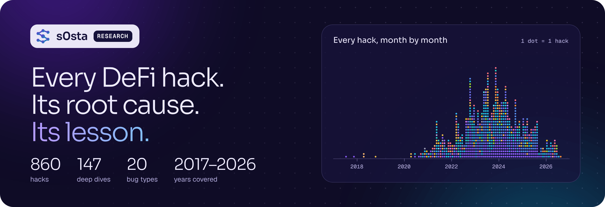
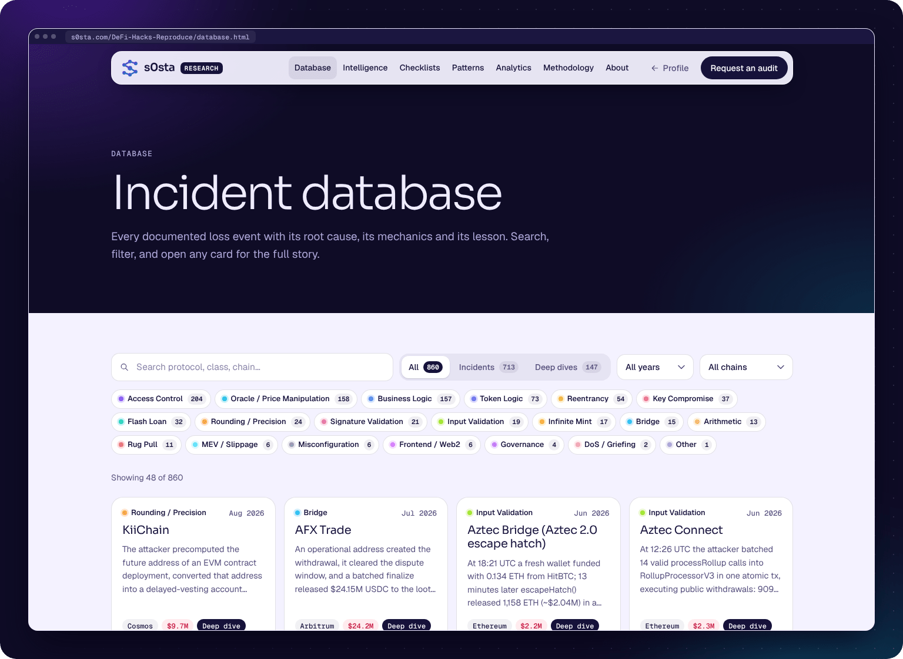

<div align="center">

<a href="https://s0sta.com/DeFi-Hacks-Reproduce/"></a>

<br>

<a href="https://s0sta.com/DeFi-Hacks-Reproduce/"></a>


### 860 real DeFi hacks. What broke, how the attacker did it, and the lesson.

Free to read. Made for **auditors, bug hunters, developers and students**.

**[Website](https://s0sta.com/DeFi-Hacks-Reproduce/)** · **[Start here](#start-in-one-minute)** · **[Bug types](#the-20-bug-types)** · **[Famous hacks](#famous-hacks)** · **[Database](database/)** · **[Deep dives](analyses/)**

</div>

<br>

## What you get for every hack

- 📅 **When and where:** the date and the blockchain
- 🐞 **The bug:** the root cause, in one clear line
- 🛠️ **How it worked:** the attacker's steps, with the real numbers
- 💡 **The lesson:** what to check, so it does not happen again
- 📰 **What happened next:** refunds, fixes and other news (in the deep dives)

## Start in one minute

1. **Open the website** → [s0sta.com/DeFi-Hacks-Reproduce](https://s0sta.com/DeFi-Hacks-Reproduce/). Search any protocol, or filter by year, chain and bug type.
2. **Learn one bug type.** Pick a type from [the list below](#the-20-bug-types) and read 3 or 4 hacks of that type. You will see the pattern fast.
3. **Before an audit**, read the hacks that look like the project you check. Use their lessons as your first checklist.

<p align="center">
  <a href="https://s0sta.com/DeFi-Hacks-Reproduce/database.html"></a>
</p>

## What is inside

| Folder or file | What it has |
|:--|:--|
| 📁 [`database/`](database/) | **713 hack cards** in 11 files, one file per time period (2017 → 2026) |
| 📁 [`analyses/`](analyses/) | **147 deep dives** in 16 volumes: the big hacks, step by step |
| 📄 [`INDEX.md`](INDEX.md) | A list of all hacks, with the file where you find each one |
| 🌐 [`site/`](site/) | The website files |
| 🎨 [`logo/`](logo/) | The s0sta logo (PNG and SVG) |

## The 20 bug types

Every hack has one main bug type. Click a type to see all its hacks on the website.

| Bug type | In simple words | Hacks |
|:--|:--|--:|
| [Access Control](https://s0sta.com/DeFi-Hacks-Reproduce/database.html?class=Access%20Control) | Anyone could call a function that only the owner or admin should call. | 204 |
| [Oracle / Price Manipulation](https://s0sta.com/DeFi-Hacks-Reproduce/database.html?class=Oracle%20%2F%20Price%20Manipulation) | The attacker moved a price that the contract trusted. | 158 |
| [Business Logic](https://s0sta.com/DeFi-Hacks-Reproduce/database.html?class=Business%20Logic) | The app's own rules had a mistake: wrong math or steps in the wrong order. | 157 |
| [Token Logic](https://s0sta.com/DeFi-Hacks-Reproduce/database.html?class=Token%20Logic) | The token itself had a bug, for example in its fees, burns or rebases. | 73 |
| [Reentrancy](https://s0sta.com/DeFi-Hacks-Reproduce/database.html?class=Reentrancy) | The contract was called again before it finished its first job. | 54 |
| [Key Compromise](https://s0sta.com/DeFi-Hacks-Reproduce/database.html?class=Key%20Compromise) | A private key, a signer or an admin account was stolen. | 37 |
| [Flash Loan](https://s0sta.com/DeFi-Hacks-Reproduce/database.html?class=Flash%20Loan) | A huge loan inside one transaction turned a small bug into a big loss. | 32 |
| [Rounding / Precision](https://s0sta.com/DeFi-Hacks-Reproduce/database.html?class=Rounding%20%2F%20Precision) | Small rounding errors, repeated many times, became real money. | 24 |
| [Signature Validation](https://s0sta.com/DeFi-Hacks-Reproduce/database.html?class=Signature%20Validation) | A signature was not checked well, so it could be faked or used again. | 21 |
| [Input Validation](https://s0sta.com/DeFi-Hacks-Reproduce/database.html?class=Input%20Validation) | The contract trusted user input without checking it. | 19 |
| [Infinite Mint](https://s0sta.com/DeFi-Hacks-Reproduce/database.html?class=Infinite%20Mint) | The attacker could create new tokens from nothing. | 17 |
| [Bridge](https://s0sta.com/DeFi-Hacks-Reproduce/database.html?class=Bridge) | A cross-chain bridge released money without a real deposit. | 15 |
| [Arithmetic](https://s0sta.com/DeFi-Hacks-Reproduce/database.html?class=Arithmetic) | Overflow, underflow or another wrong calculation. | 13 |
| [Rug Pull](https://s0sta.com/DeFi-Hacks-Reproduce/database.html?class=Rug%20Pull) | The team or the owner took the users' money. | 11 |
| [MEV / Slippage](https://s0sta.com/DeFi-Hacks-Reproduce/database.html?class=MEV%20%2F%20Slippage) | Bots traded before or around a victim's trade because its price limit was weak. | 6 |
| [Misconfiguration](https://s0sta.com/DeFi-Hacks-Reproduce/database.html?class=Misconfiguration) | A wrong setting, or a bad deploy or setup step. | 6 |
| [Frontend / Web2](https://s0sta.com/DeFi-Hacks-Reproduce/database.html?class=Frontend%20%2F%20Web2) | The website, the domain or a server was hacked, not the contract. | 6 |
| [Governance](https://s0sta.com/DeFi-Hacks-Reproduce/database.html?class=Governance) | The attacker got enough votes to pass a bad proposal. | 4 |
| [DoS / Griefing](https://s0sta.com/DeFi-Hacks-Reproduce/database.html?class=DoS%20%2F%20Griefing) | The attacker blocked the app or made it fail for other users. | 2 |
| [Other](https://s0sta.com/DeFi-Hacks-Reproduce/database.html?class=Other) | Does not fit the types above. | 1 |

## Famous hacks

New here? Start with these well-known cases.

| Hack | When | Lost | What went wrong |
|:--|:--|--:|:--|
| [Bybit](database/2025.md#bybit-cold-wallet) | Feb 2025 | ~$1.5B | The wallet's signers approved a hidden call that replaced the wallet's own code. |
| [Ronin Bridge](database/2022-h1.md#ronin-bridge) | Mar 2022 | ~$624M | Fake withdrawals passed the bridge's 5-of-9 signature check. |
| [Poly Network](analyses/volume-08.md#poly-network--2021-08-10--611m-ethereum--bsc--polygon) | Aug 2021 | ~$611M | A cross-chain message could call a protected contract and change the keeper keys. |
| [Wormhole](analyses/volume-11.md#wormhole--2022-02-02--326m-120k-weth) | Feb 2022 | $326M | A weak signature check let the attacker mint 120,000 wETH with no deposit. |
| [Euler Finance](database/2023-h1.md#euler-finance) | Mar 2023 | ~$197M | A "donate" step broke the health check, so the attacker liquidated itself for profit. |
| [Nomad Bridge](database/2022-h2.md#nomad-bridge) | Aug 2022 | $190M | A setup mistake made fake messages look valid, so anyone could copy the attack. |
| [Beanstalk](database/2022-h1.md#beanstalk) | Apr 2022 | $181M | A flash loan bought enough votes to pass a proposal that sent the funds to the attacker. |

## Search it like a developer

```bash
git clone https://github.com/s0sta/DeFi-Hacks-Reproduce.git
cd DeFi-Hacks-Reproduce

grep "^## " database/2024.md          # list all hack cards of 2024
grep -ril "oracle" database analyses  # find the files that talk about oracles
```

## Good to know

> [!NOTE]
> This archive is for **learning and defense**. Every hack here already happened and is public.
> The goal is simple: understand the bug, so the next team does not repeat it.

<br>

<div align="center">

Made by **[Hosam Hani (s0sta)](https://github.com/s0sta)** · [s0sta.com](https://s0sta.com) · [LinkedIn](https://www.linkedin.com/in/hosam-hani-abdelati/) · [X](https://x.com/s0sta_)

Need a smart contract audit? → **[Request it on s0sta.com](https://s0sta.com/#services)**

</div>
